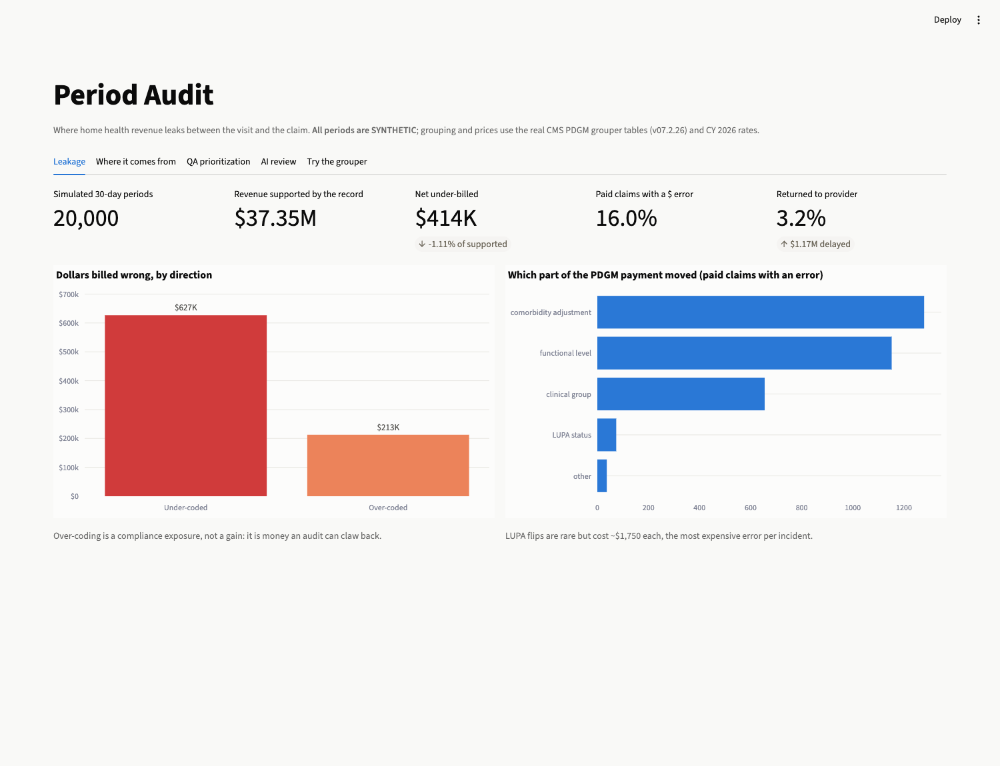
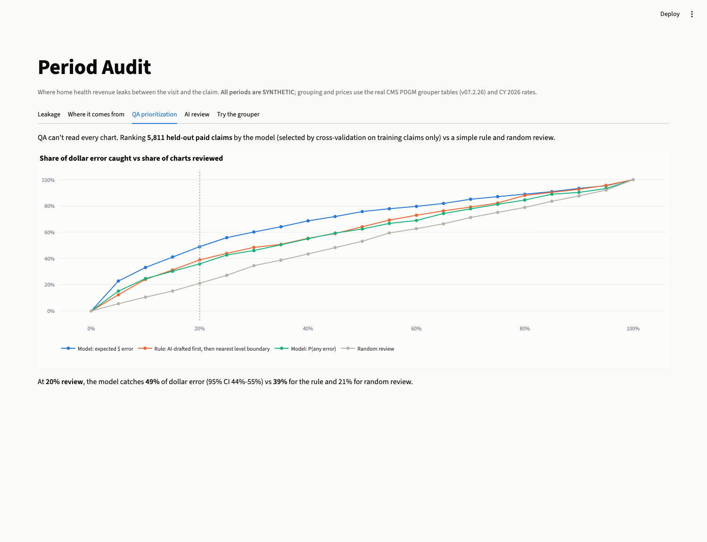
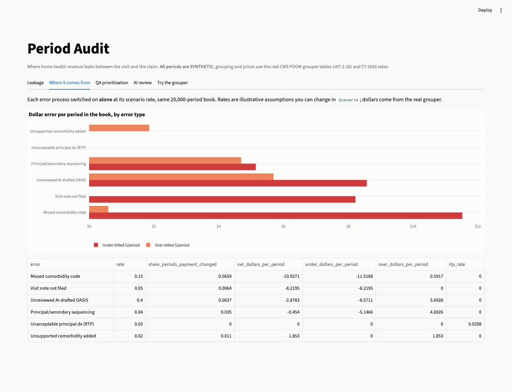
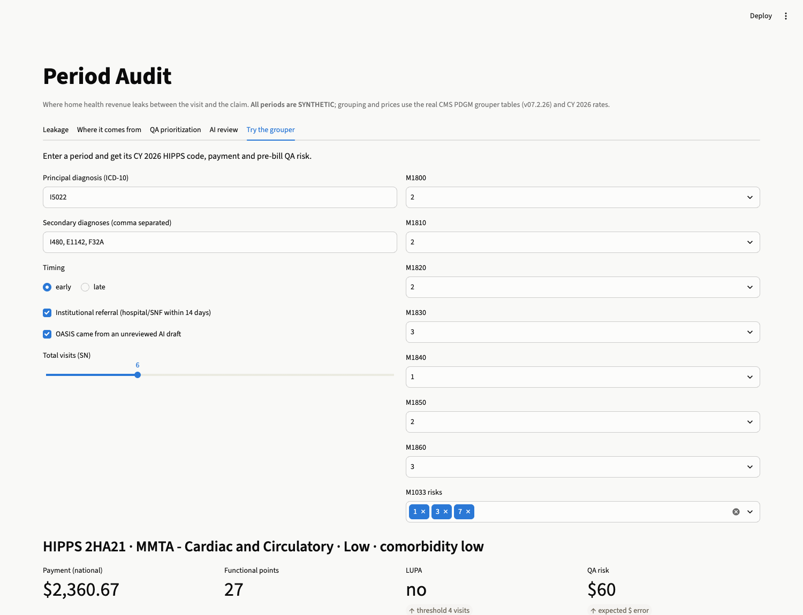

# Period Audit

**Where home health revenue leaks between the visit and the claim, and which charts QA should read first.**

**Live dashboard:** [period-audit.streamlit.app](https://period-audit.streamlit.app/)

> Under Medicare's PDGM, a 30-day home health payment is set by five things: the principal diagnosis (clinical group),
> secondary diagnoses (comorbidity adjustment), OASIS functional answers (impairment level), admission source and timing,
> and the visit count (LUPA). A coding or documentation slip in any of them changes the check, and AI scribes now write a
> lot of that documentation. This repo rebuilds CMS's PDGM grouper in Python, **verifies it against all 141 CMS test claims**,
> and uses it to price exactly what each kind of error costs and how to catch it before billing.

**The claims are SYNTHETIC. The grouper logic, diagnosis tables, case-mix weights and CY 2026 rates are real CMS data.**
Part 3 of a series. The OASIS error patterns come from [Second Read](https://github.com/DevSanjayShah05/oasis-scribe-eval)
(AI scribe evaluation), and the agency market context comes from [Agency Atlas](https://github.com/DevSanjayShah05/home-health-market-intelligence).

---

## 1. A PDGM grouper that matches CMS

`src/period_audit/grouper.py` implements the CMS Home Health Grouper Software (HHGS v07.2.26, October 2026) from its
published reference tables (74,879 ICD-10 codes, 12 clinical groups, 118 comorbidity subgroups, 98 high-comorbidity
interactions, functional points, HIPPS structure). It covers:

- **Period timing and referral source:** institutional if occurrence code 61/62.
- **Principal diagnosis validation:** unacceptable, manifestation, unspecified and external-cause codes are returned to the provider. Code-first sequencing warnings are matched against each code's specific condition list.
- **Primary awarding:** a flagged code in the first secondary position replaces the principal.
- **Functional points and levels** by clinical-group threshold.
- **Comorbidity adjustment:** high interaction beats low subgroup, and a secondary in the principal's ICD-10 subchapter is ignored.
- **HIPPS → CY 2026 case-mix weight, LUPA threshold and payment:** $2,038.22 national 30-day rate, per-visit LUPA rates and first-visit add-ons from the CY 2026 final rule.

**Validation:** `tests/test_grouper.py` runs **all 141 test claims CMS ships with the grouper** (104 that group
successfully and 37 that should fail with a specific return code and validity flag). It reproduces the expected HIPPS code, validity flag and return code for **141/141**.

Building it surfaced two details that aren't obvious from the rule text:
1. The code-first warning only fires when a secondary matches *that code's* condition list, not for any secondary.
2. **LUPA thresholds differ by HIPPS group**, so *dropping* a comorbidity code can move a low-visit period into a group with a lower
   threshold and *raise* its payment. The tests assert this explicitly.

## 2. What errors cost (20,000 synthetic periods)

Each period is generated twice: the **truth** (what the record supports) and the **claim** (after six error processes).
Both are grouped and priced, so every dollar of difference is attributable.

| Book-level result (all six error processes on) | |
|---|---|
| Revenue supported by the record | **$37.35M** |
| Under-billed / over-billed | **−$627K / +$213K** |
| Net | **−$414K (−1.11%)**, about −$20.70 per period |
| Paid claims with any payment error | **16.0%** |
| Claims returned to provider (unacceptable principal dx) | **3.2%** ($1.17M of payments delayed) |
| Functional-level mismatch / comorbidity-level mismatch on paid claims | 6.9% / 9.0% |

**Which part of the payment moved** (paid claims with an error):

| Component | Periods | Net $ | Avg \|$\| per period |
|---|---|---|---|
| Comorbidity adjustment | 1,279 | −$162,928 | $178 |
| Functional impairment level | 1,152 | −$64,608 | $237 |
| Clinical group | 655 | −$50,177 | $309 |
| **LUPA status** | **74** | **−$129,706** | **$1,753** |

LUPA flips touch **0.4% of periods but cause 31% of the net loss**. One visit note filed late can turn a full payment into a
per-visit payment.

**Each error type alone** (same book, only that process switched on at its scenario rate):

| Error process | Scenario rate | Paid claims whose payment changes | Net $ / period (whole book) | Under / over $ per period |
|---|---|---|---|---|
| Missed comorbidity code | 15% of comorbidity codes | 6.6% | **−$10.93** | −$11.52 / +$0.59 |
| Visit note not filed (LUPA risk) | 5% of periods | 0.6% | −$8.22 | −$8.22 / $0 |
| Unreviewed AI-drafted OASIS (Second Read error profile) | 40% of periods | 6.4% | −$2.88 | **−$8.57 / +$5.69** |
| Principal/secondary sequencing error | 4% of periods | 3.5% | −$0.45 | −$5.15 / +$4.69 |
| Unsupported comorbidity added | 2% of periods | 1.1% | +$1.85 | $0 / +$1.85 |
| Unacceptable principal dx | 3% of periods | (returned, not paid) | $0 | 3.0% of claims returned |

**Read the AI-draft row carefully.** Its *net* looks small because errors cancel out. Its *gross* error is among the largest,
and about 40% of it is over-billing, which is audit exposure, not upside.

### How much is reviewing AI drafts worth?

| Share of AI-drafted OASIS reaching billing unreviewed | 0% | 20% | 40% | 60% | 80% | 100% |
|---|---|---|---|---|---|---|
| Absolute $ error per period | $28 | $37 | $42 | $46 | $56 | $62 |
| Over-billed $ per period | $5 | $7 | $11 | $13 | $15 | $17 |
| Functional-level mismatch | 0.6% | 3.6% | 7.0% | 10.4% | 13.5% | 16.7% |

*(10,000 periods per point, other error rates fixed.)* The AI error profile is the one measured for a small local 7B model
in Second Read. A stronger production scribe would flatten this curve, but the shape is the argument for a QA step.

## 3. Which charts should QA read first?

QA can't review every chart before billing. A model ranks **5,811 held-out paid claims** using only what is visible on the
claim (billed OASIS answers, distance to a functional-level boundary, visits vs the LUPA threshold, comorbidity level,
OASIS consistency flags, whether the OASIS was AI-drafted). The model type was chosen by 5-fold CV **on the training claims only**.
A dollar-weighted Tweedie regressor beat a classifier, 45.0% vs 37.6% of dollar error captured at 20% review.

| Review the top… | **Model (expected $ error)** | Rule: AI-drafted first, then nearest level boundary | Model: P(any error) | Random |
|---|---|---|---|---|
| 20% of claims | **49.0%** of $ error (95% CI 44.5–54.6%) | 38.9% (34.8–43.5%) | 35.8% | 21.0% |
| 30% of claims | **60.1%** | 48.4% | 46.0% | 34.5% |

Model minus rule at 20%: **+10 points, 95% CI +3.8 to +15.5** (bootstrap over test claims). The lesson matches the first
attempt: a classifier for *any* error lost to the simple rule. Training on *dollars* is what made the model worth using.
Returned-to-provider claims are excluded because the grouper's own edit already stops 100% of them pre-bill.

---

## Dashboard and API

| Leakage | QA prioritization |
|---|---|
|  |  |
| **Error types** | **Try the grouper** (enter a period → HIPPS, payment, QA risk and reasons) |
|  |  |

`POST /group` returns HIPPS, return code, validity flag, clinical group, functional level, comorbidity, LUPA and payment
for a period. `POST /score` returns the same plus the pre-bill QA risk score and human-readable reasons (e.g. "functional
score is within 3 points of a level boundary", "visit count is at the LUPA threshold"). It returns a STOP for claims the
grouper would send back.

## Run it

```bash
make setup        # Python 3.11 venv, pinned deps
make test         # 156 tests: 141 CMS test claims + simulation invariants + API
make analyze      # simulate 20k periods → SQL summaries → isolated error runs → QA model (~1 min)
make dashboard    # Streamlit
make api          # FastAPI on :8001
make reference    # optional: re-download CMS files and rebuild data/reference
```
Docker files are included but **untested** (no Docker on the build machine).

```
src/period_audit/
  grouper.py      PDGM grouper (CMS tables), LUPA pricing           cms_claims.py  CMS fixed-width test-claim parser
  simulate.py     synthetic book + six error processes (Scenario)   analyze.py     pipeline, isolation runs, QA model
  scoring.py      single-claim pre-bill QA score + reasons
sql/leakage.sql   DuckDB summaries: book, clinical group, PDGM component, error tags
data/reference/   CMS grouper tables v07.2.26, CY2026 case-mix + rates, Second Read OASIS error matrices
data/outputs/     periods.parquet (SYNTHETIC), summary.json, CSVs, saved QA model
tests/fixtures/   CMS HHGS test claims (TestDataV07226*.txt)
```

## Data and assumptions

**Real (CMS):** grouper reference tables and test claims (HHGS v07.2.26); CY 2026 case-mix weights and LUPA thresholds
(432 groups); CY 2026 national 30-day rate $2,038.22, per-visit rates and LUPA add-on factors from the CY 2026 HH PPS final rule
(transcribed from rule tables; the build script cross-checks the comorbidity lists against the final rule's own file);
CMS Table 8 OASIS response distributions.

**Measured in project 1 (synthetic visits):** per-item OASIS confusion matrices for the AI-draft error process,
smoothed toward "correct or off by one" because each item has only 53–60 decisions.

**Assumed, and exposed in `Scenario`:** clinical-group mix, diagnosis prevalence, visit volumes (tuned to a 6.7% LUPA
rate, near the 6.6% median agency rate in Agency Atlas's CMS data), and all six error rates. The rates are illustrative,
not estimates for any real agency. The value of the project is the machinery: change a rate and every dollar figure
re-derives from the grouper.

## Limitations
- Synthetic claims; national rates without wage index, outliers or sequestration. No partial-episode payments.
- One grouper version (v07.2.26). Quarter-spanning predecessor-code substitution is not implemented; all 141 CMS test claims pass without it.
- Error processes are independent; real errors cluster by clinician and agency.
- The QA model learns the simulation's error mechanics. On real claims it would need retraining on audited outcomes;
  the pipeline (features → dollar-weighted ranking → capture-curve evaluation) is what transfers.

## License and disclaimer
MIT. Research and portfolio project, not billing or coding advice. Not affiliated with CMS or any company.
